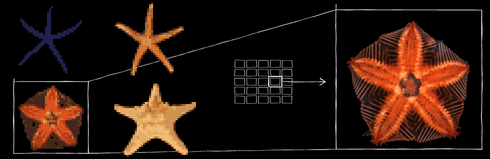

# asteroidea


[](https://www.python.org/)
[](https://aws.amazon.com/cdk/)
[](https://iceberg.apache.org/)
[](https://duckdb.org/)
[](https://www.typescriptlang.org/)
[](https://react.dev/)
[](https://vite.dev/)
[](https://nodejs.org/)

An AWS data platform for multimodal neuroscience research data (MRI images and electrophysiology
recordings), with a Python SDK and a web app.

## Purpose

asteroidea is for small research teams that analyse neural data and want simple tools with sensible
defaults.

- Primary data stays in S3. Raw files are read-only.
- An Apache Iceberg catalog holds the metadata. Researchers query the whole corpus with SQL and read
  single files lazily.
- Researchers work in a Python SDK or a web app. Administrators deploy through AWS IAM Identity Center.
- The infrastructure is Python code written with the AWS CDK. It runs in a sandbox AWS account only.

What works today: sign in, browse the catalog, query it with SQL, read NWB and NIfTI files lazily, upload
files and folders (the first uploader owns a dataset name), and add labels to a file. A researcher can save
a result with a record of the files it came from; every signed-in researcher can read it. A curator can
import a public dataset from DANDI or OpenNeuro.

Not built yet: the VPC, validation and quarantine of uploads, multipart upload, and continuous
integration.

## Architecture

An upload is registered through the API, and its bytes go straight to S3 on a presigned URL. After a
checksum check, the file is committed to the catalog. The SDK reads the catalog and S3 directly with
temporary credentials. The web app reads through the API and presigned URLs.

| Part | Role |
|---|---|
| S3 | Raw data (read-only) and derived files |
| DynamoDB | Upload sessions, dataset owners, labels, import runs and notes |
| Iceberg catalog on Glue, queried with Athena | File and dataset metadata, queried with SQL |
| Lambda functions behind API Gateway | The API: uploads, catalog reads, analysis, results, imports |
| Python SDK (`asteroidea`) | Researcher access from Python and notebooks |
| Web app (React) on S3 and CloudFront | Browse, inspect and visualize data |
| Two CDK stacks | `DataStack` (data and hosting) and `ServicesStack` (API and functions) |

The web app draws what the API returns. Saved results come only from the Python analysis module.
[Introduction](docs/src/introduction.md) and the architecture chapters in the book give the detail.

## How to use

### Researchers

If an administrator invited you, you do not need this repository. Sign in to the hosted web app, open
**Get started**, and run its one command in a terminal:

```sh
uvx --from '<link from the Get started page>' asteroidea-setup https://<hosted app>
```

The command sets up a private Python 3.14 environment with the SDK, signs you in and downloads the
exemplar notebook. It prints PASS or FAIL for each step. Then open the notebook.
[For researchers](docs/src/researchers.md) walks through each step.

### Developers

You need `git`, `uv` (0.13.5 or newer, below 0.14), Node.js 22.12 or newer (not 25) with `npx`, and the
docker daemon. Each target prints what is missing when it fails.

```sh
git clone https://github.com/droyston/asteroidea-public.git && cd asteroidea
make doctor     # check the toolchain; in a fresh clone it names only mdBook
make tools      # install the pinned mdBook into .tools/bin
make install    # Python workspace, git hooks, web packages
make check      # run every gate
make docs       # build the book; make serve shows it on port 3000, make kill stops it
make help       # list every target
```

The [developer guide](docs/src/developers.md) lists the commands by task. The live targets (`make deploy`
and the rest) need your own AWS account setup, described in [infra/account/README.md](infra/account/README.md).

## Documentation

The book is in `docs/src`.

This repository is the public release mirror: each commit is one release snapshot of the platform. Issues and pull requests are welcome.

- [Introduction](docs/src/introduction.md): what the platform is, what runs today and how the book is organised.
- [For researchers](docs/src/researchers.md): using the web app and the SDK.
- [Developer guide](docs/src/developers.md): commands, gates, layout and how to add a route.
- [Internal FAQ](docs/src/faq.md): answers to questions from onboarding, for people who build and run the platform.
- [Decisions](docs/src/09-decisions.md): the architecture decision records.

## Repository layout

| Path | Contents |
|---|---|
| `infra/` | The CDK app, the function registry, the live check runners; `infra/account/` records the sandbox setup |
| `ingest/` | The Lambda handlers, the route table and the Dockerfiles |
| `sdk/` | The researcher SDK, package `asteroidea` |
| `services/` | The dataset harvester and the NWB peek tool |
| `web/` | The web app (React, Vite, TypeScript), built with npm |
| `notebooks/` | The exemplar notebook |
| `docs/` | The book: architecture chapters, decision records, the developer guide |
| `tests/` | Workspace-level tests |
| `Makefile` | The developer commands |


The Python packages form a [uv](https://docs.astral.sh/uv/) workspace on Python 3.14. The quality gates
use ruff, ty (strict type checking) and pytest.

## License

Apache License 2.0. See [LICENSE](LICENSE).
